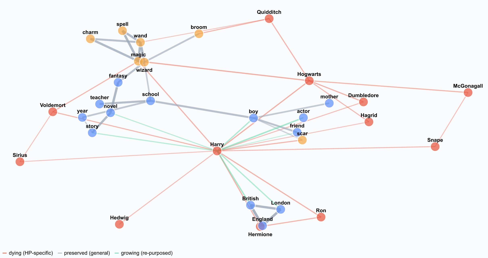

# Who's Harry Potter? A marimo walkthrough

[](https://doi.org/10.5281/zenodo.20534236)
[](LICENSE)
[](LICENSE-CONTENT.md)
[](https://github.com/JacobBowie/marimo-unlearning/actions/workflows/lint-and-build.yml)
[](https://marimo.io)
[](https://pyodide.org)



An interactive explainer of Eldan & Russinovich (2023),
[*Who's Harry Potter? Approximate Unlearning in LLMs*](https://arxiv.org/abs/2310.02238):
the paper that taught Llama-2-7B to forget Harry Potter without retraining
from scratch. Built as a portfolio piece using marimo's reactive notebook
framework; runs entirely in the browser via WebAssembly.

> 🔗 **Live notebook:** [jacobbowie.com/unlearning](https://jacobbowie.com/unlearning/).
> It runs entirely in your browser; the first visit takes 30 to 60 seconds to load.

## What this notebook is for

The 2023 paper showed that Llama-2-7B, which had cost roughly 184,000
GPU-hours to pretrain, could be made to forget Harry Potter in about
one GPU-hour of fine-tuning, with the model's general-knowledge
benchmark scores essentially unchanged. The mechanism is three small
ideas: a deliberately-reinforced HP-aware twin model, an arithmetic
trick that subtracts that twin's predictions out of the baseline, and
a dictionary of ~1,500 anchored substitutions that lets the same trick
work even when the prompt itself is HP-flavored. The interaction
between the three ideas is the substance of the paper.

This notebook walks through that mechanism interactively. The hero
visualization frames the algorithm as edge surgery on the model's
knowledge graph: HP-specific links die, the surrounding language graph
survives, and a few "re-purposed" links grow so the model has
something plausible to say when asked about Harry. Three sliders, a
prompt explorer, and a live alpha knob let a reader feel each step of
the algorithm rather than just reading about it. The notebook also
includes a candid caveats section: follow-up work (Lynch et al. 2024;
Liu et al. EMNLP 2024) has shown the unlearning is more brittle than
the paper's original familiarity metric suggested, and newer methods
(NPO, SimNPO, RMU) have largely eclipsed this technique. The paper
remains the cleanest pedagogical entry into the problem, which is why
this walkthrough sits on top of it.

## What's in here

```
notebook.py                  the polished walkthrough (single-file, self-contained)
deploy/
  citations.md               verified citations + per-claim spot-checks against
                             the source paper and HF model card
  build_wasm.sh              one-command WASM export (uv), plus the loading splash
  loading_splash.html        static "Loading the notebook" cue for the first-visit wait
  tests/wasm_smoke.py        headless-browser render gate for the exported bundle
  case_study_unlearning.qmd  drop-in Quarto template for embedding the notebook
  og_metadata.html           Open Graph + Twitter card meta tags
  social_card_brief.md       spec for the 1200×630 social preview image
  description_snippets.md    portfolio / social / HN copy at three lengths
sketches/
  comparison.py              six visualization approaches in one file (dev scratch)
  d3_force_skeleton.py       d3-force HTML embed proof-of-concept
  SKETCHES_README.md         which viz won and why
scripts/
  precompute_hf.py           extend cached completions via the released checkpoint
                             (sketched; Databricks is the cleanest compute path)
  precompute_local.py        toy gpt2 version of the unlearning pipeline (CPU-OK)
pyproject.toml               project + pinned deps (uv-managed)
uv.lock                      locked, reproducible env (committed)
Dockerfile                   optional uv image + marimo edit on :2718
docker-compose.yml           one-command local dev (optional)
.dockerignore
LICENSE                      MIT (code)
LICENSE-CONTENT.md           CC BY 4.0 (notebook prose, narrative, visualizations)
CITATION.cff                 cite-this-repository metadata (renders on GitHub)
README.md                    this file
```

The notebook's data is **inlined as Python literals** (Figures 1, 3, and 5
from the paper). Single self-contained file: ships clean to molab and bundles
small via WASM export.

## Run locally

### uv (recommended)

```bash
uv run marimo edit notebook.py     # author / preview
uv run marimo run notebook.py      # read-only app view
```

uv provisions the environment from `pyproject.toml` + `uv.lock` on first run.
No manual install step, and no global Python is required.

### Docker (optional)

```bash
docker compose up --build
```

Then open <http://localhost:2718>. Edit any `.py` file in the project from
the marimo file picker; changes persist to the host because the project dir
is bind-mounted. Stop with `Ctrl+C`, or `docker compose down`.

Lint pass:

```bash
uv run marimo check notebook.py
```

## Deploying

The live copy is served at [jacobbowie.com/unlearning](https://jacobbowie.com/unlearning/).
That site pulls the `unlearning-wasm.tar.gz` asset from this repo's GitHub
release at build time, so shipping a change means cutting a release with a
rebuilt bundle. CI also exports the bundle on every push to `main`, as a
short-lived build artifact.

To rebuild and test the bundle locally:

```bash
bash deploy/build_wasm.sh
# produces dist/unlearning/  (gitignored, regenerable)
python -m http.server 8137 --directory dist/unlearning &
SMOKE_URL=http://127.0.0.1:8137/ uv run --script deploy/tests/wasm_smoke.py
```

## Extending the cached data

The graph-viz edge weights are currently **illustrative**; the rest of the
numbers (completions, token probabilities, familiarity scores, benchmark
scores) are taken verbatim from the paper. Both the notebook and
`deploy/citations.md` say so explicitly.

To replace illustrative weights with measured ones:

- `scripts/precompute_hf.py`: skeleton script that should hit the released
  `microsoft/Llama2-7b-WhoIsHarryPotter` checkpoint over a curated cloze
  probe set, capture top-k softmax probabilities, and emit JSON that the
  notebook can load. The cleanest compute path is a one-time Databricks
  job using `transformers.AutoModelForCausalLM` with
  `generate(..., output_scores=True)`. The released checkpoint is ungated
  under the Microsoft Research License Agreement; no Llama-2 gate dance
  required for this fine-tune specifically.
- `scripts/precompute_local.py`: small gpt2-based toy pipeline for
  development and pedagogy; not used in the published notebook.

This is v0.2 work. The v0.1 notebook ships with illustrative weights and
explicit disclosure of that fact.

## Tech

[marimo](https://marimo.io) reactive notebooks · [Altair](https://altair-viz.github.io/) charts ·
[networkx](https://networkx.org) graph layout · [Pyodide](https://pyodide.org) for browser execution.

## License

- **Code:** [MIT](LICENSE)
- **Notebook prose, narrative, and visualizations:** [CC BY 4.0](LICENSE-CONTENT.md)

## Cite

Citation metadata in [`CITATION.cff`](CITATION.cff). GitHub renders a
"Cite this repository" widget on the landing page.

If you use this notebook in your own work, please also cite the original
research paper it explains:

> Eldan, R., & Russinovich, M. (2023). *Who's Harry Potter? Approximate
> Unlearning in LLMs.* arXiv:2310.02238. <https://arxiv.org/abs/2310.02238>

## Author

Built by [Jacob Bowie](https://jacobbowie.com), researcher at UCONN. Reach me
at [jacob.bowie2@gmail.com](mailto:jacob.bowie2@gmail.com).

*A 2026 [marimo](https://marimo.io) demonstration, explaining Eldan &
Russinovich (2023) and the unlearning work it set off.*
